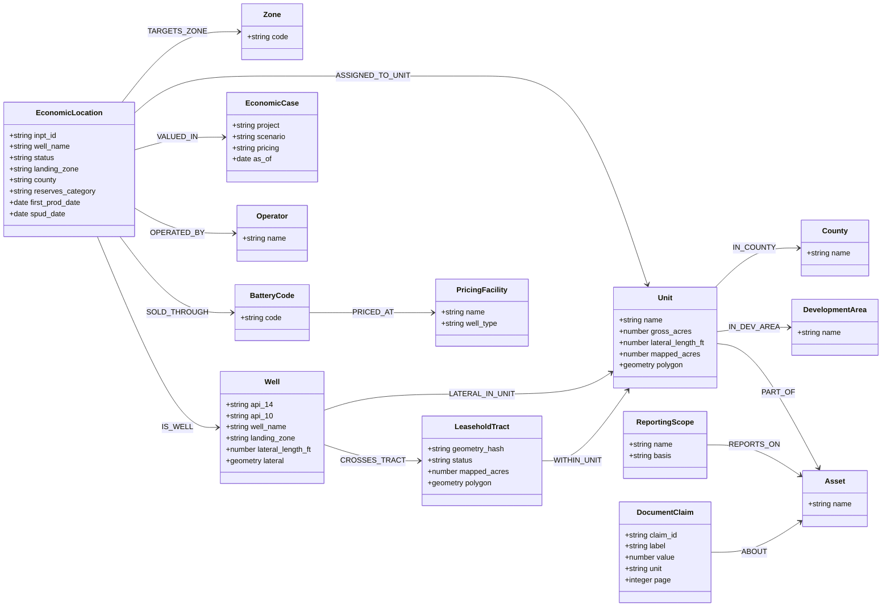

# Ontology Catalog: Data Dictionary

Catalog version **0.1.0**, status: **draft - pending XOM review**. Generated from `ontology/` by `data-room-intel catalog export`; do not edit by hand.

Upstream M&A data-room ontology for acquisition screening. Entities carry deterministic type:key IDs; every link has an inspectable build rule; measured values are facts with dimensions and source locations. Competing source values are kept side by side and reconciled through rules and review decisions.

## Entity Types

| Entity type | ID pattern | Key | Standard | Description |
|---|---|---|---|---|
| Asset | `asset:<name>` | `name` | Custom | The asset (deal) described by the data room; parent of units and reporting scopes. |
| Unit | `unit:<name>` | `name` | Custom | Drilling or spacing unit. Names are normalized for case and underscores; original spellings are kept as aliases. |
| Zone | `zone:<code>` | `code` | Custom | Geologic bench used for ownership and location counts. Landing zones map to benches through an approved alias table. |
| Well | `well:<api_14>` | `api_14` | OSDU master-data--Well | Drilled wellbore with a mapped lateral. API-14 is stored as text; API-10 is kept as an alias. |
| EconomicLocation | `location:<inpt_id>` | `inpt_id` | Custom | A row of the economics one-line. Separate from Well because 320 locations have no API (undeveloped, DUC, permit, drilling). |
| EconomicCase | `case:<project>` | `project` | Custom | Economic run (project and scenario) that valued the locations. |
| LeaseholdTract | `tract:<geometry_hash>` | `geometry_hash` | Custom | Leasehold polygon. The source has no tract ID, so the key is a hash of the geometry. |
| Operator | `operator:<name>` | `name` | Custom | Current operator. The source alias (NON-OP, LSB V) is kept on the OPERATED_BY link. |
| County | `county:<name>` | `name` | OSDU master-data--GeoPoliticalEntity | County or parish. |
| DevelopmentArea | `devarea:<name>` | `name` | Custom | Seller development area. The unit shapefile field ROAD_MAP_A carries the same values. |
| BatteryCode | `battery:<code>` | `code` | Custom | Economics battery code used for sales routing. |
| PricingFacility | `facility:<name>` | `name` | Custom | Facility named in the monthly basis report (tank battery or central tank battery). |
| ReportingScope | `scope:<name>` | `name` | Custom | Aggregate reporting group (lease operating statement tab or the economics cash-flow group). Has no well membership. |
| DocumentClaim | `claim:<claim_id>` | `claim_id` | Custom | Headline number stated in a document (KPI card or chart), compared with the computed value. |

### Asset

| Property | Type | Unit | Required | Source and meaning |
|---|---|---|---|---|
| `name` | string |  | yes | Asset name from the room inventory |

### Unit

| Property | Type | Unit | Required | Source and meaning |
|---|---|---|---|---|
| `name` | string |  | yes | Unit Details C; ComboCurve UNIT; shapefile UNIT_NAME |
| `gross_acres` | number | acres |  | Contractual gross acres (Unit Details H) |
| `lateral_length_ft` | number | ft |  | Planned lateral length (Unit Details I) |
| `mapped_acres` | number | acres |  | WGS84 geodesic area of the unit polygon |
| `polygon` | geometry |  |  | Unit polygon, EPSG:4326 |

### Zone

| Property | Type | Unit | Required | Source and meaning |
|---|---|---|---|---|
| `code` | string |  | yes | Bench code from the Unit Details zone headers |

### Well

| Property | Type | Unit | Required | Source and meaning |
|---|---|---|---|---|
| `api_14` | string |  | yes | PDP shapefile API_14; ComboCurve API 14 |
| `api_10` | string |  |  | PDP shapefile API_10; ComboCurve API 10 |
| `well_name` | string |  |  | PDP shapefile Well_Name |
| `landing_zone` | string |  |  | PDP shapefile Landing_Zo |
| `lateral_length_ft` | number | ft |  | Geodesic length of the lateral |
| `lateral` | geometry |  |  | PDP lateral line, EPSG:4326 |

### EconomicLocation

| Property | Type | Unit | Required | Source and meaning |
|---|---|---|---|---|
| `inpt_id` | string |  | yes | ComboCurve INPT ID |
| `well_name` | string |  |  | ComboCurve Well Name |
| `status` | string |  |  | ComboCurve WELL STATUS |
| `landing_zone` | string |  |  | ComboCurve Landing Zone |
| `county` | string |  |  | ComboCurve County/Parish |
| `reserves_category` | string |  |  | ComboCurve Econ PRMS Reserves Category |
| `first_prod_date` | date |  |  | ComboCurve First Prod Date |
| `spud_date` | date |  |  | ComboCurve Spud Date |

### EconomicCase

| Property | Type | Unit | Required | Source and meaning |
|---|---|---|---|---|
| `project` | string |  | yes | ComboCurve Project Name |
| `scenario` | string |  |  | ComboCurve Scenario Name |
| `pricing` | string |  |  | ComboCurve Pricing Qualifier |
| `as_of` | date |  |  | ComboCurve As Of Date |

### LeaseholdTract

| Property | Type | Unit | Required | Source and meaning |
|---|---|---|---|---|
| `geometry_hash` | string |  | yes | First 12 hex digits of the SHA-256 of the WKB geometry |
| `status` | string |  |  | Leasehold shapefile STATUS |
| `mapped_acres` | number | acres |  | WGS84 geodesic area |
| `polygon` | geometry |  |  | Tract polygon, EPSG:4326 |

### Operator

| Property | Type | Unit | Required | Source and meaning |
|---|---|---|---|---|
| `name` | string |  | yes | ComboCurve Current Operator |

### County

| Property | Type | Unit | Required | Source and meaning |
|---|---|---|---|---|
| `name` | string |  | yes | Unit Details D |

### DevelopmentArea

| Property | Type | Unit | Required | Source and meaning |
|---|---|---|---|---|
| `name` | string |  | yes | Unit Details F |

### BatteryCode

| Property | Type | Unit | Required | Source and meaning |
|---|---|---|---|---|
| `code` | string |  | yes | ComboCurve BATTERY |

### PricingFacility

| Property | Type | Unit | Required | Source and meaning |
|---|---|---|---|---|
| `name` | string |  | yes | Basis report facility column |
| `well_type` | string |  |  | Basis report Well Type |

### ReportingScope

| Property | Type | Unit | Required | Source and meaning |
|---|---|---|---|---|
| `name` | string |  | yes | LOS worksheet title or CASHFLOW group |
| `basis` | string |  |  | net or gross |

### DocumentClaim

| Property | Type | Unit | Required | Source and meaning |
|---|---|---|---|---|
| `claim_id` | string |  | yes | document slug, page and label |
| `label` | string |  |  | Claim label as printed |
| `value` | number |  |  | Claimed value |
| `unit` | string |  |  | Claimed unit |
| `page` | integer |  |  | Page number |

## Relationship Types

| Relationship | From | To | Method | Build rule |
|---|---|---|---|---|
| `IS_WELL` | EconomicLocation | Well | key | ComboCurve API 14 equals PDP API_14, both as 14-digit text |
| `ASSIGNED_TO_UNIT` | EconomicLocation | Unit | source | ComboCurve UNIT after name normalization |
| `LATERAL_IN_UNIT` | Well | Unit | spatial | PDP lateral covered by the unit polygon |
| `CROSSES_TRACT` | Well | LeaseholdTract | spatial | PDP lateral intersects the tract polygon |
| `WITHIN_UNIT` | LeaseholdTract | Unit | spatial | Tract polygon covered by the unit polygon |
| `TARGETS_ZONE` | EconomicLocation | Zone | alias | Landing Zone through the landing_zones alias table |
| `VALUED_IN` | EconomicLocation | EconomicCase | source | ComboCurve Project Name and qualifiers |
| `OPERATED_BY` | EconomicLocation | Operator | source | ComboCurve Current Operator; Current Operator Alias kept on the link |
| `SOLD_THROUGH` | EconomicLocation | BatteryCode | source | ComboCurve BATTERY |
| `PRICED_AT` | BatteryCode | PricingFacility | crosswalk | Customer-supplied battery-to-facility crosswalk (none supplied) |
| `IN_COUNTY` | Unit | County | source | Unit Details County |
| `IN_DEV_AREA` | Unit | DevelopmentArea | source | Unit Details Development Area |
| `PART_OF` | Unit | Asset | source | Room inventory |
| `REPORTS_ON` | ReportingScope | Asset | source | Room inventory |
| `ABOUT` | DocumentClaim | Asset | document | Claim extracted from a room document |

## Measures (Facts)

| Measure | Subject | Unit | Dimensions | Sources | Description |
|---|---|---|---|---|---|
| `net_acres` | Unit | acres | zone | Unit Details!K:Y | Net acres by zone |
| `total_nri` | Unit | fraction | zone | Unit Details!AA:AO | Total net revenue interest by zone |
| `base_nri` | Unit | fraction | zone | Unit Details!AQ:BE | Base net revenue interest by zone |
| `orri` | Unit | fraction | zone | Unit Details!BG:BU | Overriding royalty interest by zone |
| `nri_8_8ths` | Unit | fraction | zone | Unit Details!BW:CK | 8/8ths net revenue interest by zone |
| `operational_wi` | Unit | fraction | zone | Unit Details!CM:DA | Operational pro forma working interest by zone |
| `net_acres_with_carry` | Unit | acres | zone | Unit Details!DC:DQ | Net acres including carried interest by zone |
| `gross_locations_10k` | Unit | 10,000-ft equivalent wells | zone | Unit Details!DS:EG | Gross locations in 10,000-foot lateral equivalents by zone |
| `gis_wi` | Unit | fraction | zone | LSB_UNITS_20260806 WI_* | Working interest by zone from the unit shapefile |
| `gis_nri` | Unit | fraction | zone | LSB_UNITS_20260806 NRI_* | Net revenue interest by zone from the unit shapefile |
| `wi` | EconomicLocation | fraction | case | ONELINE!JP | Working interest (header says %, values are fractions) |
| `nri` | EconomicLocation | fraction | case | ONELINE!JQ | Net revenue interest |
| `dcf10_ky` | EconomicLocation | M$ | case | ONELINE!KY | 10% discounted cash flow, first column with that header |
| `dcf10_mf` | EconomicLocation | M$ | case | ONELINE!MF | 10% discounted cash flow, second column with the same header |
| `irr` | EconomicLocation | fraction | case | ONELINE!LR | IRR (source holds percentage points) |
| `net_oil_mbbl` | EconomicLocation | MBBL | case | ONELINE!JR | Net oil sales volume |
| `net_gas_mmcf` | EconomicLocation | MMCF | case | ONELINE!JS | Net gas sales volume |
| `net_boe_mbbl` | EconomicLocation | MBOE | case | ONELINE!JU | Net BOE sales volume |
| `net_revenue` | EconomicLocation | M$ | case | ONELINE!KD | Total net revenue |
| `perf_lateral_ft` | EconomicLocation | ft | case | ONELINE!CT | Perforated lateral length |
| `los_value` | ReportingScope | source unit | month, line_item | LOS monthly columns | Lease operating statement value (volumes, revenue, expense) by month and line item |
| `cashflow_value` | ReportingScope | source unit | month, measure | CASHFLOW | Economics cash-flow forecast for the all-wells group by month |
| `basis_value` | PricingFacility | source unit | month, section, measure | Basis report tabs | Price, differential or deduct by facility, month and report section |
| `oil_bbl` | Well | bbl | month | none in sample room | Monthly oil production |
| `gas_mcf` | Well | mcf | month | none in sample room | Monthly gas production |
| `water_bbl` | Well | bbl | month | none in sample room | Monthly water production |
| `days_on` | Well | days | month | none in sample room | Producing days in the month |

## Reconciliation Rules (version 0.1.0)

| Rule | Subject | Check | Severity | Blocks |
|---|---|---|---|---|
| `UNIT_ASSIGNMENT_CONFLICT` | Well | ComboCurve UNIT differs from the unit polygon that contains the PDP lateral | blocking | Unit-level economics totals |
| `OWNERSHIP_VALUE_CONFLICT` | Unit | Unit shapefile WI differs from Unit Details operational WI for a zone | blocking | WI and NRI answers |
| `VALUE_FIELD_CONFLICT` | EconomicLocation | ONELINE KY and MF are both labelled 10% Discount Cash Flow (M$) and differ | blocking | PV-10 answers |
| `ZONE_ALIAS_MISSING` | EconomicLocation | Landing zone has no approved bench in the landing_zones alias table | warning | Zone totals |
| `OPERATOR_ALIAS_CONFLICT` | EconomicLocation | Seller-operated location carries the operator alias NON-OP | warning | Operated versus non-operated split |
| `CROSSWALK_MISSING` | BatteryCode | Battery code has no basis-report pricing facility | info | Nothing; price answers are marked unsupported |
| `FORMULA_CACHE_MISSING` | ReportingScope | Workbook formula cell has no cached result; it is flagged, never read as zero | info | Nothing; derived values are recomputed from base facts |
| `CLAIM_MISMATCH` | DocumentClaim | Number stated in a document differs from the value computed from the room | warning | Nothing |
| `UNMATCHED_KEY` | Asset | A mapped key value in a new dataset matches no existing entity | warning | Facts from the unmatched rows |

## Alias Tables

### gis_zone_fields (proposed)

Maps the zone suffix of unit shapefile ownership fields (WI_<suffix>, NRI_<suffix>) to bench codes. MISS is treated as a misspelling of MSS.

Applies to: LSB_UNITS shapefile WI_*/NRI_* fields -> Zone.code

| Source value | Maps to |
|---|---|
| USS | USS |
| MSS | MSS |
| MISS | MSS |
| JM | JM |
| LSS | LSS |
| DEAN | DEAN |
| WCA | WCA |
| WCB1 | WCB I |
| WCB2 | WCB II |
| WCC | WCC |
| WCD | WCD |
| STBND | STR / BND |
| UPBRNT | UP BRNT |
| LRBRNT | LR BRNT |
| MSSP | MSSP |
| WDFD | WDFD |

### landing_zones (proposed)

Maps economics and map landing-zone names to the Unit Details bench codes. Needs approval from the customer's subsurface expert.

Applies to: EconomicLocation.landing_zone, Well.landing_zone -> Zone.code

| Source value | Maps to |
|---|---|
| UPR SPRB SHALE | USS |
| MID SPRB SHALE | MSS |
| JO MILL | JM |
| LWR SPRB SHALE | LSS |
| DEAN | DEAN |
| WOLFCAMP A | WCA |
| WOLFCAMP B1 | WCB I |
| WOLFCAMP B2 | WCB II |
| WOLFCAMP C | WCC |
| WOLFCAMP D | WCD |
| LWR SPRB SAND | **unmapped, decision needed** |
