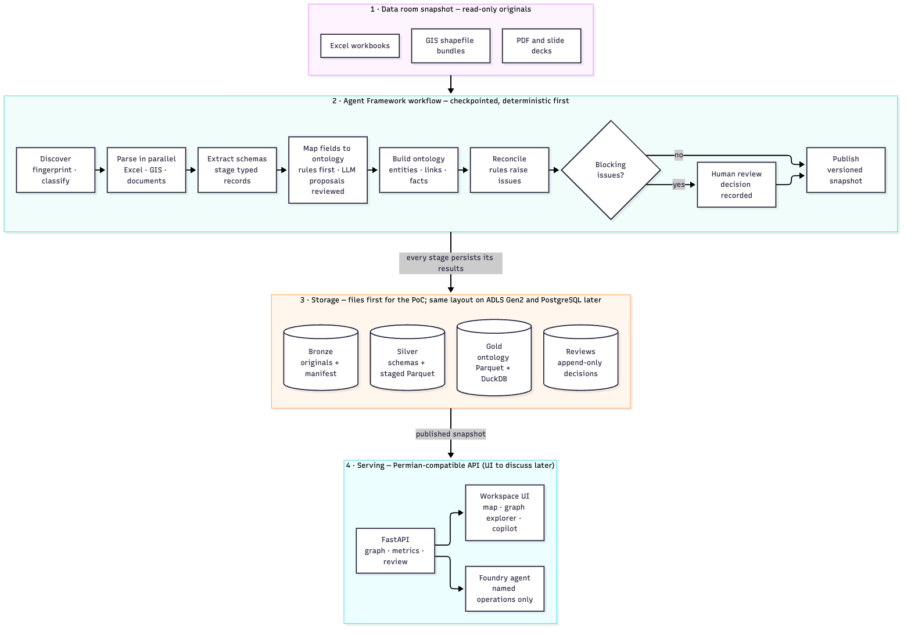
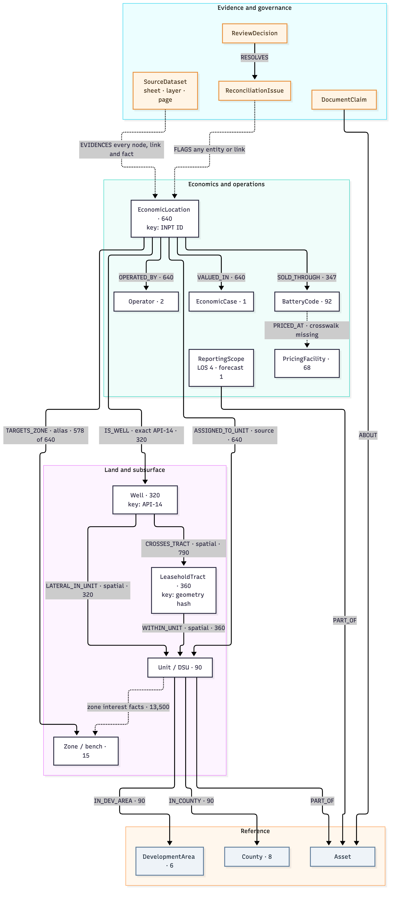
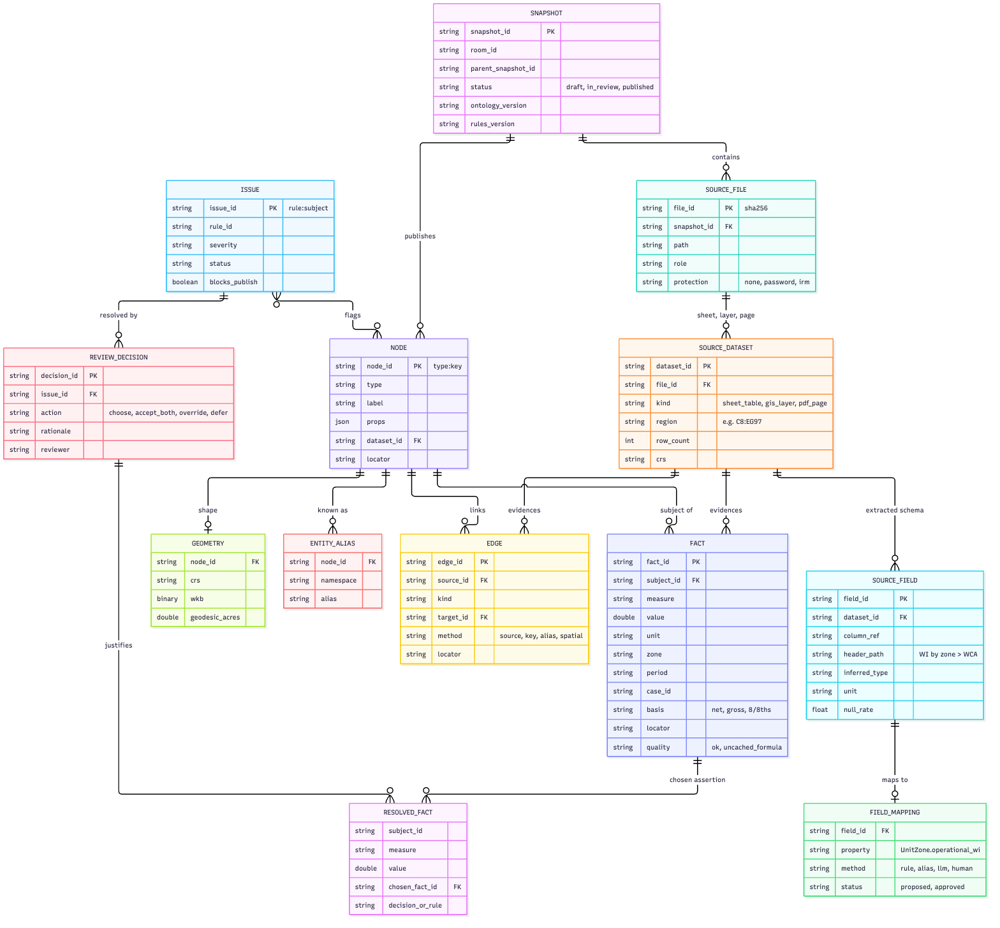

# Data Room Intelligence: Ontology Layer, Data Model and Storage

Status: **Design proposal written before implementation.** The ontology platform in this repository implements it; [HOW_IT_WORKS.md](../HOW_IT_WORKS.md) describes how it works today. Counts below come from the early prototype, so some differ slightly from the built snapshot.  
Date: 2026-10-15  
Builds on: the PoC review and plan (`POC_REVIEW_AND_PLAN.md`, not in this repository), the review of this repository at commit `3df2b65`, and the ontology layer of the Permian upstream demo (the separate `permian-upstream-demo` repository; its file names below are references, not links).

## 1. Decision Summary

1. **Continue on the peer repository; don't start over.** Keep its parsers, Pydantic models, Agent Framework/Foundry setup and CLI. Fix its data-integrity defects first, then restructure it into your three stages plus an ontology layer.
2. **Model the ontology layer on the Permian demo's knowledge graph.** That means:
   - typed entity types and typed relationships, each relationship with an explicit, testable build rule
   - deterministic IDs in the form `type:key`
   - provenance on every node, relationship and fact
   - a graph rebuilt from durable files
   - named query operations and a gap report
   - the same graph API, so the Permian map, graph explorer and copilot UI can be reused later
3. **Add two capabilities the Permian demo didn't need:**
   - **Reconciliation:** competing source values are kept side by side and never overwritten. Rules raise issues, reviewers decide, and approved answers come from resolved views.
   - **A schema registry:** every source column, attribute or page is profiled and mapped to an ontology property, so every number can be traced back to its source cell, map feature or page.
4. **Storage:**
   - **Proof of concept:** local files in Bronze, Silver and Gold layers. Gold holds the ontology as Parquet files queried through DuckDB, and the explorer graph is rebuilt in memory from Gold.
   - **Hosted pilot:** the same layout on ADLS Gen2, with Gold loaded into Azure Database for PostgreSQL with PostGIS for multi-user review.
   - **Possible upgrade:** Fabric IQ ontology, which is still in preview.
5. **Verified today on the sample room** with a temporary spike outside the workspace. The ontology built in 0.8 seconds with:
   - 1,534 entities
   - 4,815 relationships
   - 13,500 unit-zone facts
   - 770 shapes
   - 2,307 conflicts recorded rather than overwritten
6. **Change to yesterday's plan:** PostgreSQL/PostGIS was the proof-of-concept store; it is now the hosted-pilot store. The table design is the same, so moving between them needs no redesign.

These decisions are needed before work starts; see [section 11](#11-decisions-needed-and-risks):
- approve the entity and relationship catalog
- approve the storage path
- decide where the code lives
- name the customer expert who decides the domain questions

## 2. Your Expectations Mapped to the Design

| You asked for | Proposed design | Section |
|---|---|---|
| Data discovery and parsing | Discovery step (file inventory, fingerprints, shapefile bundle grouping, protected-file detection), then Excel, GIS and document parsers running in parallel | [4](#4-discovery-parsing-and-schema-extraction) |
| Intermediate results | Every stage saves its outputs and streams progress events: Bronze inventory, Silver schemas, staged records and mappings, Gold ontology and issues | [4.1](#41-intermediate-results-by-stage) |
| Schema extraction | A schema descriptor for each sheet table, map layer and page, plus a registry mapping each field to an ontology property | [4.2](#42-schema-extraction) |
| Reconciliation or ontology layer that tracks connections | Typed entities and relationships with build rules; competing assertions kept; issues and review decisions | [5](#5-ontology-layer-logical-model), [6](#6-reconciliation-model) |
| Review of the data model | Logical ontology and physical tables | [5](#5-ontology-layer-logical-model), [7](#7-physical-model-and-where-it-is-saved) |
| Where it's saved | Local files for the proof of concept, then ADLS Gen2 with PostgreSQL/PostGIS, with Fabric IQ as an option | [7.2](#72-where-it-is-saved) |
| An ontology layer like the Permian demo | Same pattern and API, with its components reused or adapted | [8](#8-query-and-api-layer), [9](#9-reuse-plan) |
| A similar UI (to discuss later) | The Permian-compatible API keeps that option open; UI reuse is deferred | [8](#8-query-and-api-layer) |

## 3. Architecture



Source: [diagrams/architecture.mmd](diagrams/architecture.mmd)

How data is kept safe and reproducible:

- **Originals are never modified.** Every derived file is keyed by snapshot, content hash, and code, ontology and rules versions. Gold can always be rebuilt from Bronze plus the review decisions, as Permian rebuilds its graph from source files and its saved writeback records.
- **Code does the calculations.** Deterministic code performs all joins, spatial links and numbers. The model only does two things:
  - It proposes field mappings and extracts document claims, which a reviewer approves before use.
  - It explains the results of named operations.

  The model never writes queries; this follows the Permian design, see `doc/ARCHITECTURE.md` §4.2 in the Permian demo.
- **Published snapshots are read-only to the API.** Review decisions are the only way people write data, and they are append-only.
- **Each run is checkpointed and repeatable.** One failed parser marks only its dataset as failed. Re-running produces the same IDs, so it never creates duplicate facts.

## 4. Discovery, Parsing and Schema Extraction

### 4.1 Intermediate Results by Stage

| Stage | Saved output | Contents | Expected for the sample room |
|---|---|---|---|
| Discover | `bronze/<snapshot>/manifest.json` and byte-identical originals | Path, SHA-256 hash, size, file type, role guess with confidence, shapefile bundle membership, protection (none, password or rights-management), date hints | 29 files; the Office lock file ignored; 4 shapefile bundles grouped; no protected files in your copy |
| Parse | `silver/<snapshot>/staged/<dataset>.parquet` | Typed records; every value keeps its source location (sheet and cell, map feature, or page) | 19 sheets, 4 map layers, 10 PDF pages |
| Extract schemas | `silver/<snapshot>/schemas/<dataset>.json` | Header hierarchy, type, unit, scale, null rate, distinct values, samples, formula and cached-value status, candidate keys | Section [4.2](#42-schema-extraction) |
| Map to ontology | `silver/<snapshot>/mappings.json` | Field to ontology property and its dimensions; method (rule, alias, model-proposed, human) and status (proposed, approved) | All fields used in this room mapped by rules; model proposals tested on a room with altered headers |
| Build and reconcile | `gold/<snapshot>/*.parquet`, `ontology.duckdb` | Entities, relationships, facts, shapes, aliases, issues, resolved facts | Counts in sections [5](#5-ontology-layer-logical-model) and [6](#6-reconciliation-model) |
| Review and publish | `reviews/decisions.jsonl`, `gold/<snapshot>/snapshot.json` | Who decided what and why; versions applied | Publishing blocked while blocking issues are open |

Run progress is also streamed as workflow events. Agent Framework 1.20 exposes intermediate outputs from selected steps, so a UI can show each stage's results as they arrive.

### 4.2 Schema Extraction

Each sheet table, map layer and page gets a schema descriptor. This is the real descriptor for one Unit Details column:

```json
{
  "field_id": "unit-details/Unit Details/CR",
  "dataset_id": "unit-details/Unit Details/C8:EG97",
  "column_ref": "CR",
  "header_path": ["OPERATIONAL PRO FORMA WORKING INTEREST BY ZONE", "WCA"],
  "inferred_type": "number",
  "scale": "fraction (0-1)",
  "rows": 90,
  "null_rate": 0.0,
  "mapping": {
    "property": "UnitZoneInterest.operational_wi",
    "dimensions": {"zone": "WCA"},
    "method": "header_rule",
    "status": "approved"
  }
}
```

What the extractor must detect in this room. Each item below was checked against the files:

- **Unit Details:** the used range is 470 rows by 138 columns, but the data occupies rows 8 to 97 with headers in rows 5 to 7. There are eight measure blocks of 15 zones each:
  - net acres `K:Y`
  - total NRI `AA:AO`
  - base NRI `AQ:BE`
  - ORRI `BG:BU`
  - 8/8ths NRI `BW:CK`
  - operational WI `CM:DA`
  - net acres with carry `DC:DQ`
  - 10,000-foot-equivalent gross locations `DS:EG`

  The same zone name repeats under every measure, so column names alone are ambiguous; the header path disambiguates them.
- **Economics one-line (ONELINE sheet):** 370 headers, of which 260 contain data.
  - The `(%)` label is unreliable. `WI Oil (%)` holds fractions from 0.05 to 0.95, while `IRR (%)` holds percentage points such as 44.17. Scale must be inferred from the values.
  - Two 10%-discount cash-flow columns share a name (`KY` and `MF`). Both are kept as separate fields.
- **Monthly cash flow (CASHFLOW sheet):** 52 months by 53 numeric measures for the group "all wells". It is a reporting-group series, not per-well data.
- **Lease operating statements (LOS):** 4 reporting scopes in a wide monthly layout, unpivoted to 7,936 values. Annual total columns are checks, not periods. 1,165 monthly formula cells have no cached value and must be flagged, never read as zero.
- **Basis report:** 7 monthly tabs, each with a previous-month section (119 rows across all tabs) and a forward-12-months section (308 rows), totalling 6,538 values. Repeated facility names across sections are not duplicates.
- **GIS:** 4 layers, all EPSG:4326, with 90, 90, 320 and 360 features. The shapefile field `WI_MISS` is mapped to the MSS zone by an alias rule.
- **PDFs:** 18 headline-number cards across the two decks become document claims to compare with computed numbers.

What runs as code and what uses a model:

| Task | Deterministic code | Model, always validated |
|---|---|---|
| Table regions and headers | Header-band and summary-row detection, merged cells, repeated-zone patterns | Proposes boundaries only when the code's confidence is low |
| Field meaning | Exact rules and alias tables | Proposes a mapping to an ontology property for unfamiliar headers, as structured output checked against the catalog; stored as `proposed` until approved |
| Units and scale | Unit text in headers plus value ranges | Not used |
| PDF content | Native text and page layout | Claim extraction; Document Intelligence only for scanned pages |

## 5. Ontology Layer (Logical Model)



Source: [diagrams/ontology.mmd](diagrams/ontology.mmd)

### 5.1 Entity Types

| Entity type | ID example | Source | Sample count | Notes |
|---|---|---|---|---|
| Asset | `asset:lone-star-basin` | Room inventory | 1 | Parent of units and reporting scopes |
| Unit (drilling/spacing unit) | `unit:desert-basin-east` | Unit Details rows 8-97; unit shapefiles | 90 | Names normalized for case and `_`; original spellings kept as aliases |
| Zone (bench) | `zone:wca` | Unit Details zone headers | 15 | Landing zones map to benches through an approved alias table |
| Well | `well:42901144110000` | PDP laterals shapefile; ComboCurve API 14 | 320 | API-14 stored as text; API-10 and API-12 kept as aliases. OSDU `master-data--Well`, as in Permian |
| EconomicLocation | `location:INPT8CiDhiY7Et` | ComboCurve ONELINE | 640 | Separate from Well: 320 locations have no API (undeveloped, DUC, permit, drilling) |
| EconomicCase | `case:2608-lsb-budget` | ComboCurve qualifiers | 1 | Price deck $75/$3.50; as-of and discount date 2026-10-01 |
| LeaseholdTract | `tract:g-<geometry hash>` | Leasehold shapefile | 360 | No source ID exists, so the ID is a hash of the geometry (unique across all 360) |
| Operator | `operator:lone-star-basin-operating-llc` | ComboCurve; PDP shapefile | 2 | Source alias (`NON-OP`, `LSB V`) kept on the relationship |
| County, DevelopmentArea | `county:sage` | Unit Details | 8, 6 | County uses OSDU `GeoPoliticalEntity`, as in Permian |
| BatteryCode | `battery:BATTERY32` | ComboCurve BATTERY | 92 | Economics battery codes |
| PricingFacility | `facility:badger-compass-tank-battery` | Basis report tabs | 68 | No crosswalk to BatteryCode yet |
| ReportingScope | `scope:lsbiv-net` | LOS tabs; CASHFLOW group | 4 + 1 | Net or gross basis; aggregate only, no well membership |
| DocumentClaim | `claim:asset-overview:p2:avg-wi` | PDFs, briefing | 18 KPI cards | Compared with computed metrics |
| SourceFile, SourceDataset, SourceField | `dataset:<file>/<sheet>/<region>` | Discovery and schema extraction | 29 files | Lineage for every node, relationship and fact |
| ReconciliationIssue | `issue:unit-assignment:well:42901144110000` | Reconciliation rules | 2,307 conflicts, plus gaps | One node per issue (see [6](#6-reconciliation-model)) |
| ReviewDecision | `decision:<uuid>` | Reviewers | 0 at start | Append-only |

Where Permian already maps a type to an OSDU standard schema (Well, County), reuse that mapping. Treat the other types as custom until they are checked against the OSDU definitions.

### 5.2 Relationships

Every relationship has a build rule that can be inspected, as in Permian's `backend/graph/build.py`: source attributes, exact keys, approved alias tables, or spatial predicates. Nothing uses fuzzy matching.

| Relationship | From and to | Build rule | Method | Sample result |
|---|---|---|---|---|
| `IS_WELL` | EconomicLocation to Well | Exact API-14 as text | key | 320 |
| `ASSIGNED_TO_UNIT` | EconomicLocation to Unit | ComboCurve `UNIT` after name normalization | source assertion | 640, all resolved |
| `LATERAL_IN_UNIT` | Well to Unit | Lateral lies entirely within the unit polygon | spatial | 320; only 3 agree with `ASSIGNED_TO_UNIT` |
| `CROSSES_TRACT` | Well to LeaseholdTract | Lateral intersects the tract | spatial | 790 pairs; 319 wells |
| `WITHIN_UNIT` | LeaseholdTract to Unit | Tract lies entirely within the unit polygon | spatial | 360, each in exactly one unit |
| `TARGETS_ZONE` | EconomicLocation to Zone | Landing-zone alias table | alias | 578 of 640; `LWR SPRB SAND` (62 locations) unmapped |
| `VALUED_IN` | EconomicLocation to EconomicCase | Case qualifiers | source | 640 |
| `OPERATED_BY` | EconomicLocation to Operator | `Current Operator`, alias on the relationship | source | 640 |
| `SOLD_THROUGH` | EconomicLocation to BatteryCode | `BATTERY` | source | 347 |
| `PRICED_AT` | BatteryCode to PricingFacility | Customer-supplied crosswalk | crosswalk | 0, a known gap |
| `IN_COUNTY`, `IN_DEV_AREA` | Unit to County or DevelopmentArea | Unit Details attributes | source | 90 each |
| `PART_OF` | Unit or ReportingScope to Asset | Room inventory | source | 95 |
| `ABOUT` | DocumentClaim to Asset or Zone | Claim extraction | document | One per claim |
| `FLAGS` | ReconciliationIssue to any node | Rule output | rule | 2,307 |
| `RESOLVES` | ReviewDecision to ReconciliationIssue | Reviewer action | human | None yet |

The proposed landing-zone aliases need approval from the customer's subsurface expert:

| Landing zone | Bench |
|---|---|
| `UPR SPRB SHALE` | `USS` |
| `MID SPRB SHALE` | `MSS` |
| `JO MILL` | `JM` |
| `LWR SPRB SHALE` | `LSS` |
| `DEAN` | `DEAN` |
| `WOLFCAMP A` | `WCA` |
| `WOLFCAMP B1` | `WCB I` |
| `WOLFCAMP B2` | `WCB II` |
| `WOLFCAMP C` | `WCC` |
| `WOLFCAMP D` | `WCD` |
| `LWR SPRB SAND` | No bench in Unit Details; must be decided |

### 5.3 Facts (Measures)

Measures are stored as fact rows, not graph nodes. Each row records its subject, measure, unit, dimensions and source location. The explorer reads facts on demand.

| Fact family | Subject and dimensions | Source | Sample volume |
|---|---|---|---|
| Unit-zone interest | Unit by zone by measure (8 Unit Details blocks) | Unit Details | 10,800 |
| GIS ownership attributes | Unit by zone by WI and NRI | 2026-08-06 unit shapefile | 2,700 |
| Location economics | EconomicLocation by case by measure, keeping both 10% columns and IRR | ComboCurve ONELINE | 640 rows |
| Forecast | ReportingScope ("all wells") by case by month by measure | CASHFLOW | 52 months by 53 measures |
| Operating actuals | ReportingScope by month by line item, net or gross | LOS | 7,936 values; 1,165 flagged uncached formulas |
| Price basis | PricingFacility by month by section by measure | Basis report | 6,538 values |
| Shapes | Unit, Well, LeaseholdTract | Shapefiles | 770; WKB round-trip verified; 47 KB |

### 5.4 Example: One Well Across Sources

API `42901144110000`, well name `JARDINE 4-27 A 4LS`:

- **ComboCurve:**
  - location `INPT8CiDhiY7Et`, status producing, landing zone `MID SPRB SHALE`
  - unit `BADGER_DRAW_` (Sage County, North Cimarron)
  - operator Lone Star Basin Operating LLC, aliased `NON-OP`
  - WI 0.1944, NRI 0.1497, battery `BATTERY32`
  - 10% columns 6,817.0 and 5,936.0 thousand dollars ($M); IRR 44.2%
- **GIS:**
  - the lateral lies in unit `GOLDEN CROSSING WEST` (Aguila County, East Red Mesa) and crosses 3 leasehold tracts
  - the landing zone agrees with ComboCurve
- **Ontology result:**
  - both unit links are kept (`ASSIGNED_TO_UNIT` and `LATERAL_IN_UNIT`), even though they disagree on unit, county and development area
  - the well is flagged with `UNIT_ASSIGNMENT_CONFLICT`, and its location with `VALUE_FIELD_CONFLICT`
  - the battery has no pricing link
  - its two-hop graph neighborhood has 4 wells, 2 units, 6 tracts, 9 locations and 17 of its own issues, which gives a readable explorer view

### 5.5 Where the Catalog Comes From and How New Datasets Are Handled

The entity and link **types** in [5.1](#51-entity-types) and [5.2](#52-relationships) were designed, not mined automatically. They come from three sources:

- the model the customer asked for (briefing slide 10: Asset, Unit, Well, Ownership, Economics and Production, linked by well and unit keys)
- the questions on slide 8
- the identifiers actually present in the sample files

The **instances** and link results (90 units, 320 wells, 317 conflicts, and so on) are computed from the files by code. The spike hard-coded the types; the build would keep them in a versioned `ontology/catalog.yaml`.

How much can be found automatically? A scan that was given no entity types read all 23 datasets (1,093 columns) and four map layers in 0.5 seconds. It looked for identifier columns whose values recur in other files, plus spatial relationships between layers:

| Catalog link | Found by the scan? | Evidence |
|---|---|---|
| EconomicLocation to Well | Yes | API-14 shared 320/320; API-10 and well name also match |
| Unit across files, and location to unit | Yes | The same 90 unit names in ComboCurve, Unit Details and both unit shapefiles |
| Unit to County and to DevelopmentArea | Yes | 8 counties and 6 development areas shared; it identified the GIS field `ROAD_MAP_A` as development area |
| Well in unit, tract in unit, well crosses tract | Yes | Spatial tests: 320/320, 360/360, 319/320; the two unit layers have identical geometry (90/90) |
| Battery to pricing facility | Found as a gap | 0 shared values |
| Location to zone | No | ComboCurve and GIS share 11 landing-zone names, but Unit Details uses bench codes (`WOLFCAMP A` vs `WCA`), so an alias table is needed |
| Unit-by-zone ownership | Not from values | It comes from header structure (zones repeated under 8 measure blocks), which schema extraction detects |
| Operator, case, status | Not treated as keys | Too few distinct values to be identifiers; they stay attributes |
| What the links mean | No | People decide: EconomicLocation vs Well, which WI governs, which column is PV-10 |

The scan also found a second unit column: `Pad Name` equals `UNIT` on all 640 rows, so it is an alias, not independent evidence. ComboCurve's county agrees with its unit's county on all 640 rows, so the 317 unit conflicts are a real disagreement between ComboCurve and the map, not a typo in one column.

Seven datasets shared no identifiers with any other: five ComboCurve support tabs, the DSU-CTB schedule and the leasehold layer. Leasehold tracts link only through geometry. The LOS tabs share line-item labels, a common chart of cost codes rather than entity keys.

In short, automatic discovery proposes most of the joins; people supply the meaning and decide which source wins.

What happens when a new dataset arrives:

| Case | Example | What the system does | Who approves |
|---|---|---|---|
| Same kind of file, new layout or headers | Another seller's unit workbook | Schema extraction profiles it; known headers map by rule or alias; the model proposes mappings for unknown headers; approved mappings are remembered | Reviewer, once per new header |
| New source of existing entities | A production file keyed by API-14 | The scan matches its ID column to existing wells, shows the match rate and proposes a link | Reviewer; the accepted link becomes a rule |
| New concept | Lease or title schedule, AFEs, reserves report | The scan and headers suggest a new entity type and links (the model can draft names); proposed as a versioned catalog change | Data-model owner; the snapshot is rebuilt with the new catalog version, and older snapshots keep theirs |
| Nothing links | A standalone memo | Kept in Silver and searchable; listed in the gap report as an unlinked dataset | Optional follow-up |
| New file format | LAS well logs | Needs a new parser (code); everything after parsing is reused | Developer |

New data never silently changes the model. Mappings and catalog changes stay proposals until approved, and every snapshot records which catalog version built it.

## 6. Reconciliation Model

The model keeps assertions, rules, issues, decisions and resolved views separate:

1. Every source value or link is stored as an **assertion** and never overwritten.
2. **Rules** compare assertions and create one **issue** node per conflict, with a deterministic ID such as `issue:<rule>:<subject>`. Re-running reproduces the same IDs instead of duplicating issues, and keeping issues separate avoids a single hub node: in the spike, one shared issue node pulled 34 unrelated wells into a single well's neighborhood.
3. A reviewer records a **decision**: choose an assertion, accept both, override with a reason, or defer. The workflow pauses for this through Agent Framework's `request_info` mechanism.
4. **Resolved views** pick values using approved precedence rules plus decisions. Every resolved value points to the assertion and the decision or rule behind it. Answers on topics with open blocking issues are labeled unresolved.

What the rules find in the sample room:

| Rule | What it checks | Sample result | Blocks publishing? (proposed) |
|---|---|---|---|
| `UNIT_ASSIGNMENT_CONFLICT` | ComboCurve unit compared with the unit containing the lateral | 317 of 320 wells | Yes, for unit-level economics totals |
| `OWNERSHIP_VALUE_CONFLICT` | GIS WI compared with Unit Details operational WI, per unit and zone | 1,350 of 1,350. GIS NRI matches none of the 3 Unit Details NRI blocks (1 coincidental match) | Yes, for WI and NRI answers until source precedence is approved |
| `VALUE_FIELD_CONFLICT` | The two 10%-discount cash-flow columns | 640 of 640 | Yes, for PV-10 |
| `ZONE_ALIAS_MISSING` | Landing zones with no bench | 62 `LWR SPRB SAND` locations | Only for zone totals |
| `CROSSWALK_MISSING` | Battery codes with no pricing facility | 92 codes, 0 matches | No; price answers marked unsupported |
| `FORMULA_CACHE_MISSING` | LOS formulas with no cached value | 1,165 monthly cells | No; derived metrics recomputed from base facts |
| `CLAIM_MISMATCH` | Document claims compared with computed metrics | Avg WI 51.1% in the PDF vs 49.1% computed (no match); primary-bench net acres 38,664 vs 38,663.82 (match) | No |
| `OPERATOR_ALIAS_CONFLICT` | Operator name compared with its alias | 483 locations labeled `NON-OP` under Lone Star Basin Operating LLC | Only for the operated vs non-operated split |

How the Wolfcamp A question is answered without hiding conflicts. Every number below came from DuckDB queries over the spike's Gold tables:

- Net WCA acres from Unit Details: **38,663.82**
- WCA net locations, in 10,000-foot equivalents (gross locations x operational WI): **96.98**
- WCA economic locations, shown by status with both 10% columns until an expert chooses which one is PV-10:

| Status | Locations | 10% column `KY` ($MM) | 10% column `MF` ($MM) |
|---|---:|---:|---:|
| Producing | 32 | 343.4 | 146.6 |
| Undeveloped | 19 | 188.3 | 87.7 |
| DUC | 8 | 73.7 | 44.6 |
| Drilling | 7 | 81.0 | 40.9 |
| Permit | 4 | 13.1 | 22.6 |

## 7. Physical Model and Where It Is Saved



Source: [diagrams/storage-model.mmd](diagrams/storage-model.mmd)

### 7.1 Tables

| Table | Grain | Purpose |
|---|---|---|
| `snapshot` | One row per data room version | Status (draft, in review, published) and the code, ontology and rules versions used |
| `source_file`, `source_dataset`, `source_field` | File, then sheet/layer/page, then column/attribute | File inventory and extracted schemas, the lineage backbone |
| `field_mapping` | One row per source field | Which ontology property and dimensions a field feeds, and how that was decided |
| `node`, `entity_alias` | One row per entity | `type:key` ID, label, properties, source location; every known spelling of the entity |
| `edge` | One row per relationship assertion | Kind, endpoints, method (source, key, alias, spatial), source location |
| `fact` | One row per measured value | Subject, measure, value, unit, zone, period, case, basis, source location, quality flag |
| `geometry` | One row per shape | WKB, CRS, geodesic area; GeoParquet metadata added so GIS tools can read it |
| `issue`, `review_decision` | One row per issue; one per decision | Conflicts, whether they block publishing, and the human decisions |
| `resolved_fact` | One row per approved answer value | The chosen assertion plus the rule or decision that justified it |

### 7.2 Where It Is Saved

| Layer | Proof of concept (now) | Hosted pilot | Option if the customer mandates Fabric |
|---|---|---|---|
| Bronze: originals and inventory | Local data folder outside Git (`DRI_DATA_ROOT`) | ADLS Gen2 `bronze` container | OneLake Files |
| Silver: schemas, staged records, mappings | JSON and Parquet | ADLS Gen2 `silver` | Lakehouse |
| Gold: ontology tables | Parquet plus a DuckDB file per snapshot | ADLS Gen2 `gold`, loaded into Azure Database for PostgreSQL Flexible Server with PostGIS | Delta tables bound to a Fabric IQ ontology (preview) |
| Graph for the explorer | NetworkX in memory, rebuilt from Gold at startup, as in Permian | Same; recursive SQL or Apache AGE only if needed | Fabric Graph, optional |
| Review decisions | `reviews/decisions.jsonl`, append-only | PostgreSQL table | Lakehouse table |
| Application host | Laptop, home server, or one Azure Container Apps app (Permian precedent) | Azure Container Apps with Entra ID | Fabric workspace plus app |

Proposed folder layout:

```text
DRI_DATA_ROOT/                     # outside the Git repo; never commit customer rooms
  rooms/<room_id>/
    bronze/<snapshot_id>/originals/...   manifest.json
    silver/<snapshot_id>/schemas/<dataset_id>.json
                        staged/<dataset_id>.parquet
                        mappings.json    run_events.jsonl
    gold/<snapshot_id>/nodes.parquet  edges.parquet  facts.parquet  geometries.parquet
                      aliases.parquet issues.parquet resolved_facts.parquet
                      ontology.duckdb  snapshot.json
    reviews/decisions.jsonl
    checkpoints/<run_id>/
<repo>/ontology/catalog.yaml        # entity types, properties, relationship kinds
<repo>/ontology/aliases/*.yaml      # landing zones, unit spellings (expert-approved)
<repo>/ontology/rules.yaml          # reconciliation rules, severity, what blocks publishing
```

### 7.3 Why This Storage

| Option | Assessment |
|---|---|
| **Local files with Parquet and DuckDB** (proof of concept) | No infrastructure; rebuilds deterministically; portable to PostgreSQL, Fabric or Databricks. The spike built in 0.8 seconds into about 0.4 MB of Parquet. DuckDB allows one writer at a time, which is fine for a single reviewer. |
| **PostgreSQL with PostGIS** (hosted pilot) | Transactional multi-user review, spatial SQL, Entra authentication and private networking. Current docs list PostGIS 3.6.1 on PostgreSQL 14-18, Apache AGE 1.7.0 on 17-18 (requires a preload setting), and pgvector 0.8.2. |
| **Fabric IQ ontology and Graph** (upgrade path) | Native entity types, data bindings, rules and agents over OneLake. Still in preview; the old experience retires on January 31, 2027. Adopt if XOM standardizes on Fabric, as the Permian demo also planned. |
| **A dedicated graph database** (not now) | Unnecessary at roughly 1,500 entities and 5,000 relationships per room, and it adds a second store of record. Revisit for cross-deal graphs at much larger scale. |

## 8. Query and API Layer

The copilot follows Permian's query-layer decision (`doc/ARCHITECTURE.md`): it routes a question to a named operation and fills in validated parameters, but it never writes SQL or graph queries.

Proposed named operations:
- `room_overview`
- `unit_profile(unit)`
- `well_profile(api)`
- `zone_summary(zone, population, value_field)`
- `locations(zone, status, unit)`
- `conflicts(rule, entity)`
- `gap_report`
- `lineage(entity_or_fact)`
- `snapshot_diff(a, b)`

| Endpoint | Purpose | Compared with Permian |
|---|---|---|
| `GET /api/graph/stats`, `/gaps`, `/operations` | Counts, missing relationships, operation catalog | Same |
| `POST /api/graph/ask` | Route, run the named operation, explain the result | Same flow |
| `GET /api/graph/viz/schema`, `/viz/search`, `/viz/neighborhood`, `/viz/interpret` | Ontology overview, entity search, neighborhood graph, entity card | Same; the entity card adds facts, sources and issues |
| `POST /api/graph/rebuild` | Rebuild from Gold | Same |
| `GET /api/rooms/{room}/manifest`, `/schemas`, `/mappings` | Browse intermediate results | New |
| `GET /api/rooms/{room}/issues`, `POST .../issues/{id}/decision` | Review queue | New |
| `POST /api/rooms/{room}/snapshots/{id}/publish`, `GET .../layers/{layer}` | Publish; GeoJSON map layers | New |

Keeping these endpoints identical means the Permian graph explorer, copilot and map components can be reused when we discuss the UI.

## 9. Reuse Plan

### 9.1 From the Permian Demo

Permian is a beta prototype at commit `3e17e28`, deployed on Azure Container Apps and the home server. Its graph tests exist but were not re-run today because its environment lacks FastAPI; the repository was left unchanged.

| Component | Source | Disposition | Change needed |
|---|---|---|---|
| Ontology registry and `type:key` IDs | `backend/graph/schema.py` | Adapt | New catalog |
| Graph build with spatial index | `backend/graph/build.py` | Adapt | Read Gold tables; reuse the spatial-index (STRtree) pattern |
| Named operations and gap report | `backend/graph/query.py` | Adapt | New operations |
| Graph visualization endpoints | `backend/graph/viz.py` | Reuse | Labels and search priority for new types |
| Graph API router | `backend/graph/api.py` | Reuse | Review endpoints in a separate router |
| Copilot routing | `backend/graph/agent.py` | Adapt | New routes; Foundry client from the peer repo |
| Writeback ingestion | `backend/graph/writeback.py` | Adapt | Becomes review-decision ingestion |
| Workflow graph | `backend/pipelines/seismic_workflow.py` | Reference only | Uses `set_start_executor`, which no longer exists in Agent Framework 1.20; rewrite against the current builder |
| Map, graph explorer, copilot UI | `frontend/src/components` | Reuse later | Part of the UI discussion |
| Graph tests | `tests/test_api.py` | Adapt | New expected counts |

Never copy `backend/.env`, `deploy/homeserver/.ep-resource-ids.json`, run outputs or decision data.

### 9.2 Peer Repository to Target Modules

| Peer module | Target | Action |
|---|---|---|
| `discovery.py` | `discovery/`: inventory, bundles, protection detection, role rules | Rebuild on the existing base |
| `excel_io.py` | Removed | Delete; its Windows Excel and CSV path corrupted the API IDs |
| `parsers.py` | `adapters/excel/*`, `adapters/gis.py`, `adapters/documents.py`, `profiling/schema.py` | Split. Keep the Unit Details offsets, fix IRR, keep both value columns |
| `models.py` | `ontology/catalog.py`, `contracts.py` | Extend |
| `reconcile.py` | `reconcile/rules.py` with `ontology/rules.yaml` | Rewrite to record conflicts; never overwrite |
| `analytics.py` | `query/operations.py` | Turn into named operations |
| `pipeline.py`, `workflow.py` | `workflow/executors.py`, `workflow/graph.py` | Split into an Agent Framework graph with checkpoints and a review step |
| `reporting.py`, `fimu.py` | Same | Read from Gold and resolved views |
| `agent.py`, `debug_server.py` | `agent/`, unchanged | Tools call named operations |
| New | `api/` (Permian-compatible), `storage/` (Parquet, DuckDB) | Add |

## 10. Build Phases and Acceptance

| Phase | Delivers | Exit criteria |
|---|---|---|
| 0. Data-integrity fixes | Peer repo defects fixed | Original workbook restored; native reads; IDs as text; IRR populated for 640/640; unit assignments never overwritten; both value columns kept; discovery limited to the data room |
| A. Discovery and schema extraction | Bronze inventory and Silver schemas, staged records and mappings | Every count in [4.1](#41-intermediate-results-by-stage) and [4.2](#42-schema-extraction) reproduced; the automatic key and spatial scan reproduces the links in [5.5](#55-where-the-catalog-comes-from-and-how-new-datasets-are-handled); re-runs produce identical outputs; protected files and Office lock files handled |
| B. Ontology and reconciliation | Gold tables, issues, review step, publishing | 1,534 entities, 4,815 relationships, 13,500 unit-zone facts, 770 shapes; every issue count in [6](#6-reconciliation-model) reproduced; decisions applied through resolved views; Gold rebuilds identically from Bronze plus decisions |
| C. API and agent | Permian-compatible endpoints, named operations, copilot | The Wolfcamp A answer reproduces the section 6 numbers with both value columns and populations labeled; routing and provenance tests pass; the copilot never generates queries |
| D. UI (to discuss) | Map, graph explorer, copilot, data-room/schema panel, review queue | Agreed after the UI discussion |
| E. Hosted pilot | ADLS Gen2, PostgreSQL/PostGIS, Container Apps, Entra ID | Same tests pass against PostgreSQL; access limited to each deal; security review |

## 11. Decisions Needed and Risks

Decisions:

1. Approve the entity and relationship catalog. You are approving the types; instances are computed from the files (see [5.5](#55-where-the-catalog-comes-from-and-how-new-datasets-are-handled)). Look especially at three separations:
   - EconomicLocation from Well
   - BatteryCode from PricingFacility
   - each issue as its own node
2. Approve the storage path: local files for the proof of concept, PostgreSQL/PostGIS for the hosted pilot, and Fabric IQ as an upgrade. Or tell us now if XOM requires Fabric.
3. Where the code lives: a branch in `Vijisoms/data-room-intelligence` or a new repo in `customer_workshop`; and where the data folder lives.
4. Questions for the customer's domain experts:
   - landing-zone mapping, including `LWR SPRB SAND`
   - which WI and NRI source wins
   - which 10% column is PV-10
   - what "operated" means
5. Which issue types block publishing.

Risks:

- Permian's graph tests were not re-run today, and its workflow code uses an older Agent Framework builder API. Port that code; don't copy it.
- Conflicts in the synthetic sample may come from how the data was generated. Confirm with the customer before presenting them as findings.
- The accuracy of model-proposed schema mappings hasn't been measured. Test it on a held-out room or a copy with altered headers.
- DuckDB allows one writer at a time; multi-user review needs PostgreSQL.
- Fabric IQ ontology is in preview.
- Customer data must never be committed. Rights-management-protected files can't be parsed, so ask the customer for unprotected copies.

## 12. Evidence and Verification Log

All checks ran on 2026-10-15.

- **Permian demo:** reviewed the commit history (latest `3e17e28`, Azure Container Apps deployment), `doc/ARCHITECTURE.md` §4.2 (graph storage, build rules, query decision), `schema.py` (17 entity types, 15 relationships) and the graph tests in `tests/test_api.py`. The test run failed while collecting tests because FastAPI is missing; the repository's Git status was unchanged.
- **Agent Framework 1.20.0** (the peer repo's pinned version) provides:
  - `WorkflowBuilder(start_executor, checkpoint_storage, output_from, intermediate_output_from)`
  - `add_edge`, `add_fan_out_edges` and `add_fan_in_edges`
  - `FileCheckpointStorage`
  - `WorkflowContext.request_info`
- **Microsoft documentation:**
  - [Azure Database for PostgreSQL extensions](https://learn.microsoft.com/en-us/azure/postgresql/extensions/concepts-extensions-versions) (page dated 2026-07-10)
  - [Fabric IQ ontology overview](https://learn.microsoft.com/en-us/fabric/iq/ontology/overview) (preview; updated 2026-10-06)
  - [Fabric IQ overview](https://learn.microsoft.com/en-us/fabric/iq/overview)
- **Automatic link scan** in `/tmp`, given no entity types: 23 datasets, 1,093 columns and 4 map layers in 0.5 seconds; results in [5.5](#55-where-the-catalog-comes-from-and-how-new-datasets-are-handled). The first run failed on an Office lock file (`~$Lone Star Basin ComboCurve...xlsx`, created 2026-10-15 11:41 while the workbook was open), confirming discovery must skip lock files.
- **Temporary spike** in `/tmp`, not committed, using DuckDB 1.5.6, PyArrow 25.0.1, NetworkX 3.7 and Python 3.13:
  - built in 0.79 seconds into about 0.43 MB of Parquet
  - produced the entity, relationship, fact, issue, Wolfcamp A and shape results shown above
  - left the source files unchanged
